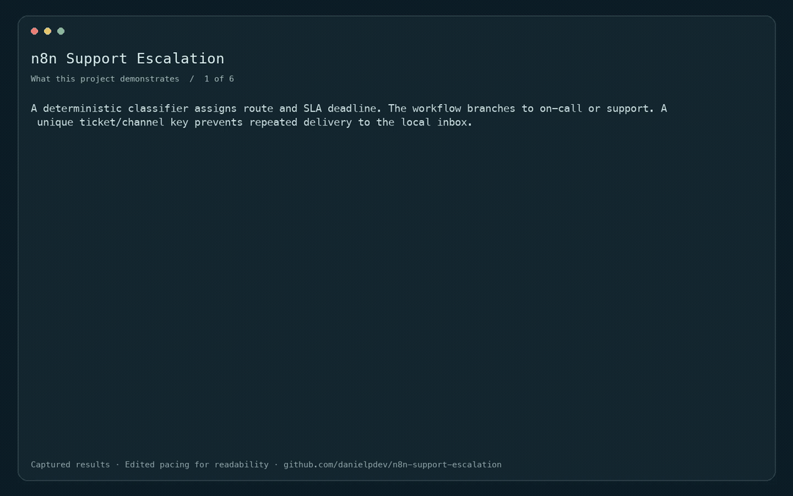
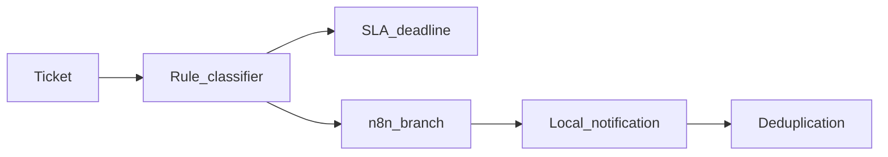

# n8n Support Escalation

Ticket routing, SLA deadlines and deduplicated local notifications.

[](https://github.com/danielpdev/n8n-support-escalation/actions/workflows/ci.yml)

**Role focus:** n8n / Support Automation. **Status:** working local portfolio implementation, with synthetic data.

## Demo



Edited replay of captured CLI outputs in deterministic fixture mode. This is not live model inference. [Full recording](docs/demo.mp4). Rebuild with `./scripts/render_gif.sh` (FFmpeg required).

## The engineering decision

A deterministic classifier assigns route and SLA deadline. The workflow branches to on-call or support. A unique ticket/channel key prevents repeated delivery to the local inbox.



## Run locally

Requirements: Python 3.12, [uv](https://docs.astral.sh/uv/getting-started/installation/) and Make.

```bash
git clone https://github.com/danielpdev/n8n-support-escalation.git
cd n8n-support-escalation
make setup
make demo
make test
make eval
```

`make demo` uses an isolated temporary database where relevant, so it is safe to repeat. `make eval` writes a timestamped report to `reports/evaluation-fixture.json`. Fixture mode is deterministic and does not represent model inference. There is no recurring hosting or API subscription cost.

`make serve` opens the local API on `http://127.0.0.1:8114/docs`.

### Execute the real n8n workflow

With Docker Engine + Compose (or Colima on macOS):

```bash
./scripts/run-workflow.sh
```

This builds the local mock API, imports `workflows/main.json`, then executes it through n8n's CLI. `reports/n8n-execution.json` contains the measured node results from an actual run. To inspect visually, run `docker compose up -d n8n`, open `http://localhost:5680`, complete local owner setup, and import the workflow JSON. No credentials are embedded.

All destinations point to the local `mock` service. No real CRM, email, Slack or customer system is contacted. Stop only this project's containers with `docker compose down`; data volumes are retained.

[Watch the recorded demo](docs/demo.mp4) · [Reproduce the walkthrough](docs/DEMO.md)

## Verification and evidence

Urgent routing, exact SLA boundary, incorrect-channel rejection and duplicate notification. The exported branch workflow executed in n8n.

- [Evaluation report](reports/evaluation-fixture.json) — measured during an actual run; inspect the mode and dataset size.
- [Development and authorship](docs/DEVELOPMENT.md).
- [Romanian interview preparation](docs/INTERVIEW_RO.md).
- [Design notes](docs/DESIGN.md).
- [Demo walkthrough](docs/DEMO.md).

CI uses standard GitHub-hosted runners and deterministic tests without downloading LLM weights. The lockfiles record exact package versions. Local-model results, when present, live in `reports/evaluation-local.json`; hardware/model identities are in `reports/environment.json`.

## Limits and next iteration

Rules are a transparent baseline, not an LLM classifier. The inbox is local; no Slack, email or real on-call person is contacted. SLA status is queried, not scheduled by a background monitor.

Next: Add business calendars, escalation timers and an authorized notification adapter.

The local demonstration does not include production authentication, secret management or operational service guarantees. Bind it to localhost and use synthetic data. These projects demonstrate engineering decisions; they do not claim real customers, paid production deployments or guaranteed interviews.

## Project ownership

Implemented with Codex assistance for Daniel Popa. The owner should review the code, run it, make an independent change and rehearse the tradeoffs before presenting it at interview. That human understanding check is pending and cannot be verified automatically. See [development notes](docs/DEVELOPMENT.md).

MIT for original source; dependencies/models retain their own licenses. See [third-party notices](THIRD_PARTY.md).
